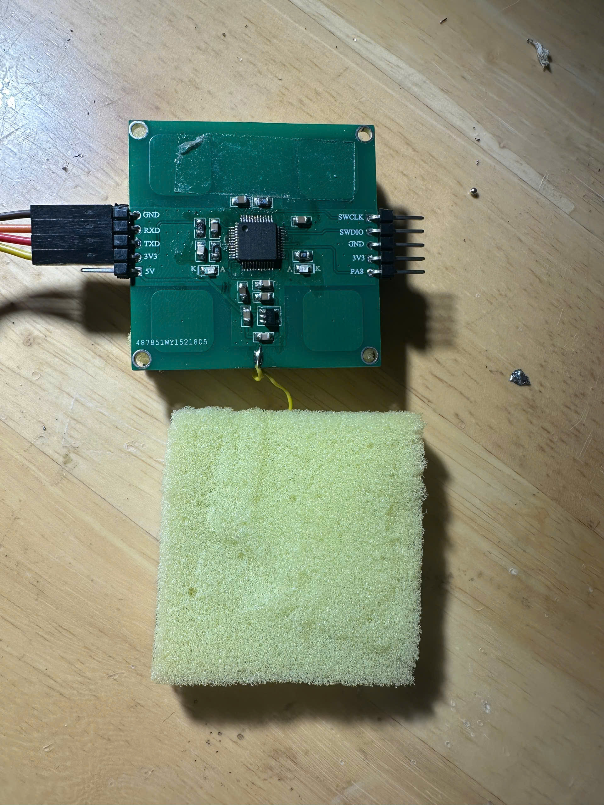
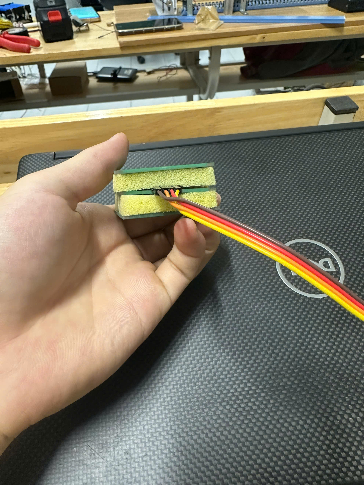
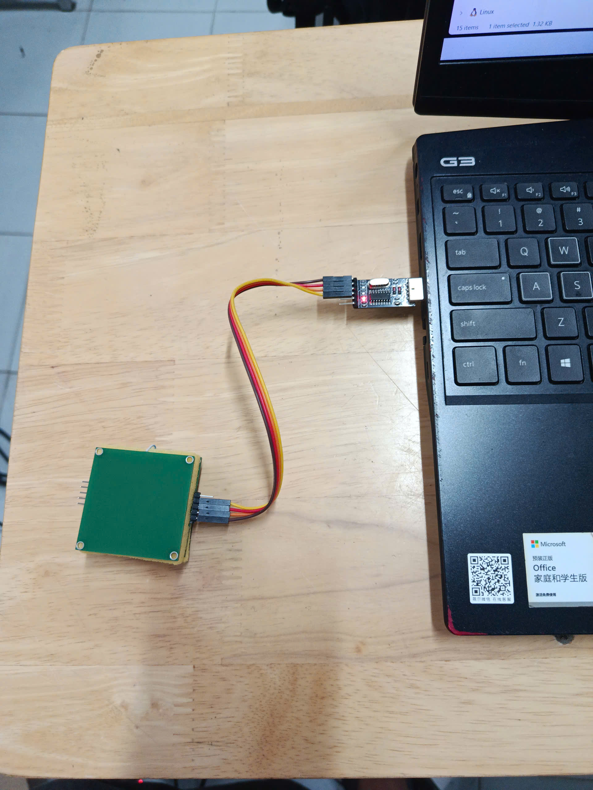
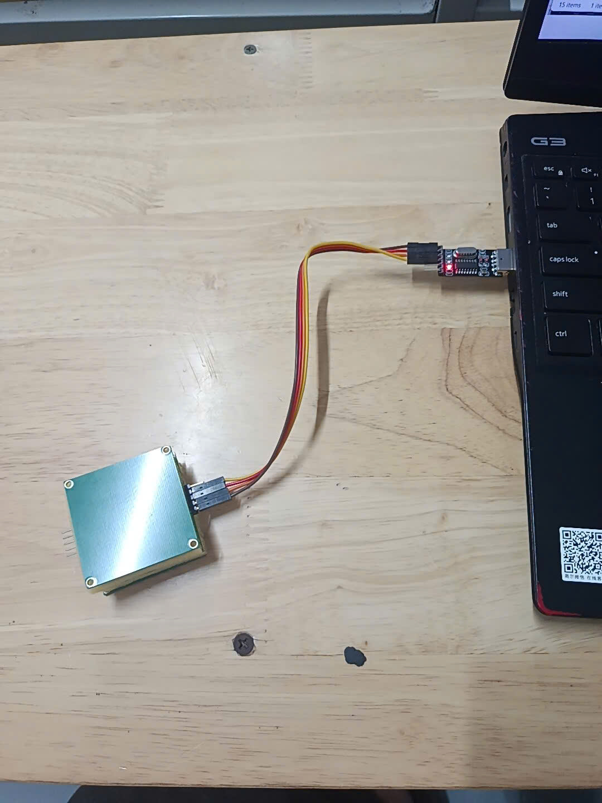
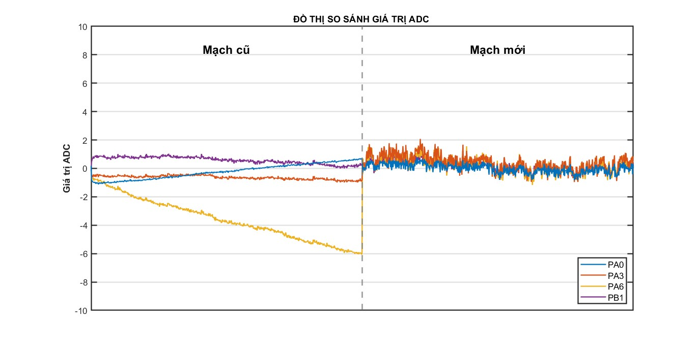
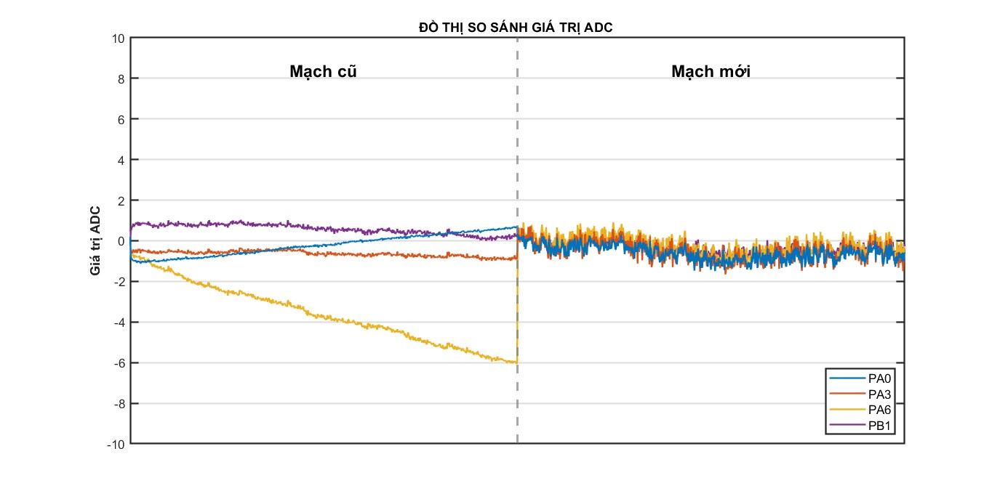

# Báo cáo tiến độ nghiên cứu ngày 24/10/2026
## A. Công việc đã làm
- Hàn linh kiện vào mạch để so sánh với mạch đã hàn trước đo
- So sánh giá trị khi không tác động của cảm biến mới hàn với cảm biến cũ trước đó
## B. Khó Khăn
## C. Báo cáo chi tiết 
### 1. Source code
https://github.com/anpham2k5/bao_cao_24_10/tree/master/STM32_ADC_Touch/src
### 2. Mạch mới sau hàn

  
  

### 3. Đồ thị so sánh cảm biến cũ và cảm biến mới
- Mạch cũ đo 90 mẫu tổng thời gian 79.92ms
#### Hình ảnh lúc đo
##### Cảm biến cũ hàn trước đó

##### Cảm biến mới

##### Đồ thị so sánh mạch mới hàn đo 100 mẫu tổng thời gian 80.36ms với mạch cũ đã hàn trước đó

##### Đồ thị so sánh mạch mới hàn đo 99 mẫu tổng thời gian 79.55ms với mạch cũ đã hàn trước đó

##### Nhận xét:
- Mạch mới giá trị xấp xỉ 0-2 nhưng bị nhiều gai nhọn
